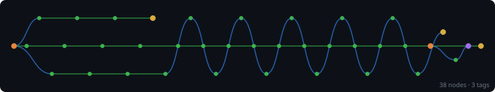

# themes

<p align="center">
  <a href="https://github.com/XAOSTECH/themes"></a>
  <a href="https://github.com/XAOSTECH/themes/releases"></a>
  <a href="https://github.com/XAOSTECH/themes/blob/main/LICENSE"></a>
</p>

<p align="center">
  <a href="https://github.com/XAOSTECH/themes/actions">
    
  </a>
  <a href="https://github.com/XAOSTECH/themes/issues">
    
  </a>
  <a href="https://github.com/XAOSTECH/themes/pulls">
    
  </a>
  <a href="https://github.com/XAOSTECH/themes/stargazers">
    
  </a>
  <a href="https://github.com/XAOSTECH/themes/network/members">
    
  </a>
</p>

<p align="center">
  
  
  
  
</p>

<p align="center">
  
  
</p>

---

<p align="center">
  <b>Design themes (GRUB, GTK, vscode-workspace, e.a.)</b>
</p>

---

> **Note:** This repository is part of the [**design-tools**](https://github.com/XAOSTECH/design-tools) monorepo.  
> 📚 [**View full documentation →**](https://xaostech.github.io/design-tools)

---

## 📋 Table of Contents

- [Overview](#-overview)
- [Features](#-features)
- [Installation](#-installation)
- [Usage](#-usage)
- [Configuration](#-configuration)
- [Documentation](#-documentation)
- [Contributing](#-contributing)
- [Roadmap](#-roadmap)
- [Support](#-support)
- [Licence](#-licence)
- [Acknowledgements](#-acknowledgements)

---

## 🔍 Overview

Design themes (GRUB, GTK, vscode-workspace, e.a.)

### Why themes?

The `themes` project centralises desktop and editor theming assets so visual design can be shared, versioned, and reused across environments.

---

## ✨ Features

- 🚀 **GTK Themes** - [README](../GTK/README.md)
- 🔧 **GNOME Shell Styling** - Coordinated shell CSS and asset variants
- 📦 **Packaged Variants** - Static and animated theme flavours
- 🔒 **Readable Contrast Choices** - Colour sets tuned for practical usability
- ⚡ **Monorepo Integration** - Versioned alongside `design-flows`
- 🔁 **Runtime Palette Cycling** - Random kitty + starship palette per terminal (sub-15ms, no pastel at launch)

---

## 📥 Installation

### Prerequisites

- GNOME Shell with user-theme extension (for shell themes)
- GTK 4-capable desktop applications
- `gsettings` available for shell theme switching

### Quick Start

```bash
# Clone the repository
git clone https://github.com/XAOSTECH/themes.git
cd themes

# Run installation
./install.sh

# Or manual installation
cp -r GTK/* ~/.themes/
gsettings set org.gnome.desktop.interface gtk-theme "NeonPink"
```

### Package Managers

```bash
# npm
echo "No npm package is published for this repository"

# yarn
echo "No yarn package is published for this repository"

# apt (Debian/Ubuntu)
echo "Install by cloning the repository and copying theme assets"

# brew (macOS)
echo "Homebrew package not available"
```

---

## 🚀 Usage

### Basic Usage

```bash
cd GTK
ls
```

### Advanced Usage

```bash
gsettings set org.gnome.shell.extensions.user-theme name "NeonPink"
gsettings set org.gnome.desktop.interface gtk-theme "NeonPink"
```

### Examples

<details>
<summary>📘 Example 1: Activate Static Theme</summary>

```bash
gsettings set org.gnome.shell.extensions.user-theme name "NeonPink"
gsettings set org.gnome.desktop.interface gtk-theme "NeonPink"
```

</details>

<details>
<summary>📗 Example 2: Activate Animated Variant</summary>

```bash
gsettings set org.gnome.shell.extensions.user-theme name "NeonPink_Animated"
```

</details>

---

## 🎨 Runtime palette cycling

Alongside the desktop themes, this repository ships a terminal/shell palette cycler that selects a random colour palette on every new interactive shell and points kitty and starship at it.
Generation happens in the `tuiGen` flow in [design-flows](https://github.com/XAOSTECH/design-flows); this repository stores the pre-generated palettes and activates them, so the shell-startup path never runs `pastel`.
See [`bin/themes-cycle.sh`](../bin/themes-cycle.sh) and the palette assets in [`assets/palettes/`](../assets/palettes/).

### Install the cycler

1. Make the palettes discoverable — either copy the assets into place or point `THEMES_DIR` at this checkout:

   ```bash
   # Option A — copy
   mkdir -p ~/.config/themes
   cp -r assets/palettes assets/fallback ~/.config/themes/

   # Option B — point at the repo
   export THEMES_DIR="$PWD/assets"
   ```

2. Add a permanent include to `~/.config/kitty/kitty.conf` (the cycler swaps the target atomically):

   ```conf
   include current-theme.conf
   ```

3. Source the hook from your shell startup file so `STARSHIP_CONFIG` is exported into the shell:

   ```bash
   # bash — ~/.bashrc   /   zsh — ~/.zshrc
   . /path/to/themes/bin/themes-cycle.sh

   # fish — ~/.config/fish/config.fish (scaffold)
   source /path/to/themes/bin/themes-cycle.fish
   ```

Open a new terminal and the palette changes.
If no palette is available, the cycler drops back to the fixed fallback profile (`#0a0512` / `#100e23` / `#ff00aa`).

---

## ⚙️ Configuration

### Environment Variables

| Variable | Description | Default |
|----------|-------------|---------|
| `XDG_CONFIG_HOME` | User configuration root used by desktop components | `~/.config` |
| `XDG_DATA_HOME` | User data root that may contain theme assets | `~/.local/share` |
| `THEMES_DIR` | Base directory the palette cycler reads (`palettes/`, `fallback/`) | `~/.config/themes` |

### Configuration File

```yaml
# config.yml
theme:
  shell: NeonPink
  gtk: NeonPink
  variant: static
```

---

## 📚 Documentation

| Document | Description |
|----------|-------------|
| [📖 Getting Started](docs/GETTING_STARTED.md) | Quick start guide |
| [📋 API Reference](docs/API.md) | Complete API documentation |
| [🔧 Configuration](docs/CONFIGURATION.md) | Configuration options |
| [❓ FAQ](docs/FAQ.md) | Frequently asked questions |

---

## 🤝 Contributing

Contributions are welcome! Please read our [Contributing Guidelines](CONTRIBUTING.md) before submitting PRs.

1. Fork the repository
2. Create your feature branch (`git checkout -b feature/AmazingFeature`)
3. Commit your changes (`git commit -m 'Add some AmazingFeature'`)
4. Push to the branch (`git push origin feature/AmazingFeature`)
5. Open a Pull Request

See also: [Code of Conduct](CODE_OF_CONDUCT.md) | [Security Policy](SECURITY.md)

---

## 🗺️ Roadmap

- [x] NeonPink static GNOME Shell + GTK variant
- [x] NeonPink animated GNOME Shell variant
- [x] Runtime palette cycler for kitty + starship (bash/zsh, fish scaffold)
- [ ] Add additional colourway variants
- [ ] Add installer script hardening and validation
- [ ] Add screenshots and preview gallery automation

See the [open issues](https://github.com/XAOSTECH/themes/issues) for a full list of proposed features and known issues.

---

## 💬 Support

- 📧 **Email**: maintainers@xaostech.dev
- 💻 **Issues**: [GitHub Issues](https://github.com/XAOSTECH/themes/issues)
- 💬 **Discussions**: [GitHub Discussions](https://github.com/XAOSTECH/themes/discussions)
- 📝 **Wiki**: [GitHub Wiki](https://github.com/XAOSTECH/themes/wiki)

---

## 📄 Licence

Distributed under the GPL-3.0 License. See [`LICENSE`](LICENSE) for more information.

---

## 🙏 Acknowledgements

- GNOME Shell and GTK theming communities
- [pastel](https://github.com/sharkdp/pastel) for colour exploration
- XAOSTECH contributors and testers

---

<p align="center">
  <a href="https://github.com/XAOSTECH">
    
  </a>
</p>

<p align="center">
  <a href="#themes">⬆️ Back to Top</a>
</p>

<!-- TREE-VIZ-START -->



[Full SVG](../.github/static/tree-viz/git-tree.svg) · [Interactive version](../.github/static/tree-viz/git-tree.html) · [View data](../.github/static/tree-viz/git-tree-data.json)

<!-- TREE-VIZ-END -->
